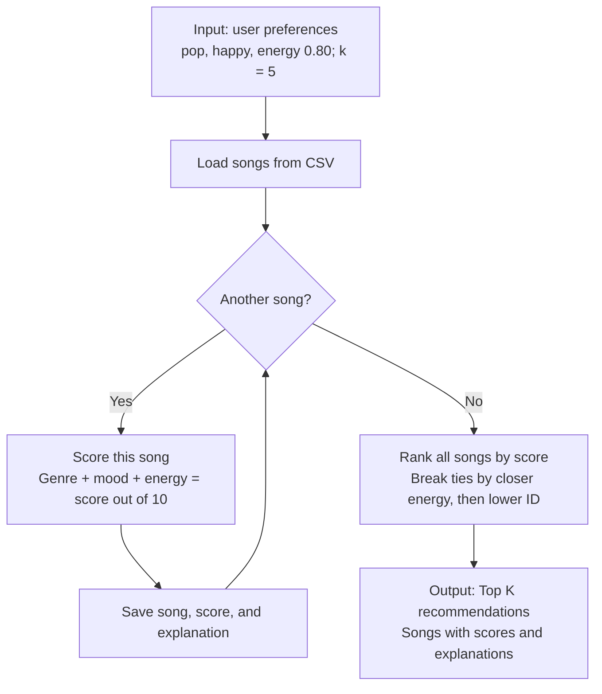

# Recommendation data flow

Planned logic from [plan.log](plan.log), shown as a UML activity-style diagram using Mermaid.

Every song is scored before selecting the top K. Scoring rules, validation, and empty-input behavior are defined in `plan.log`.
